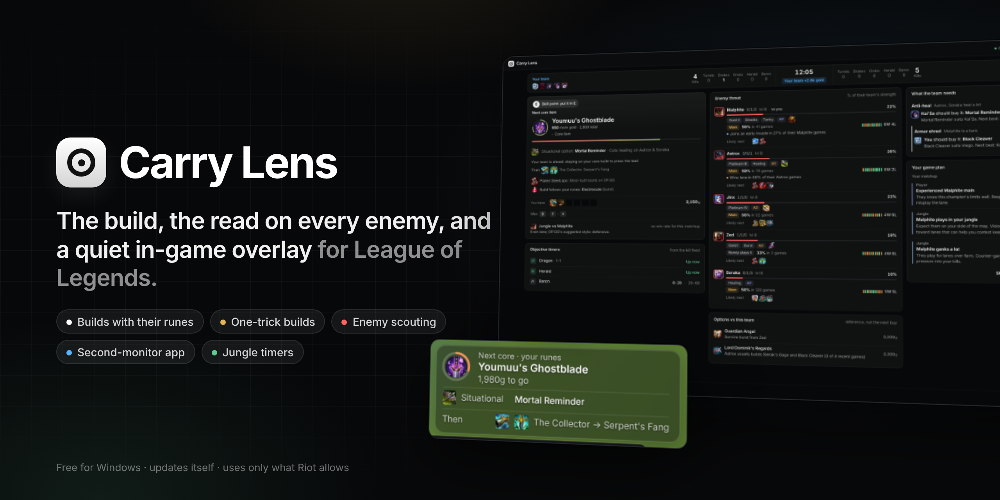
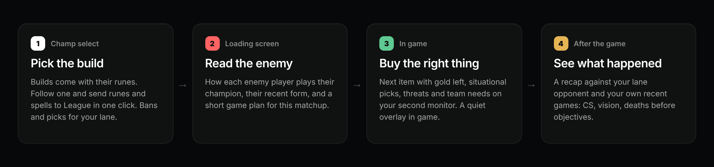
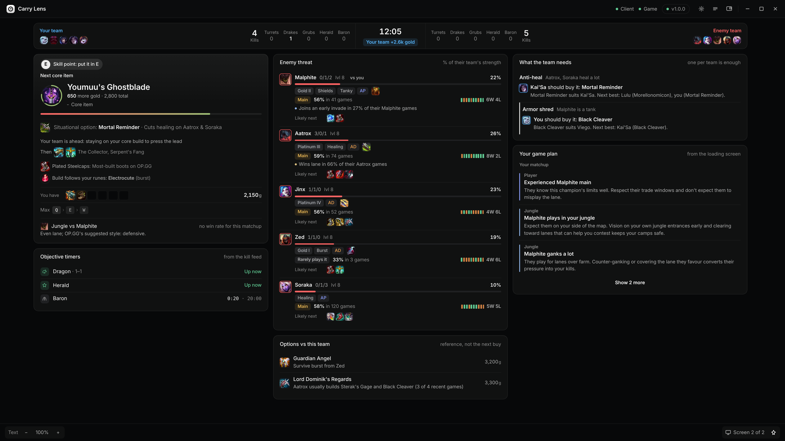
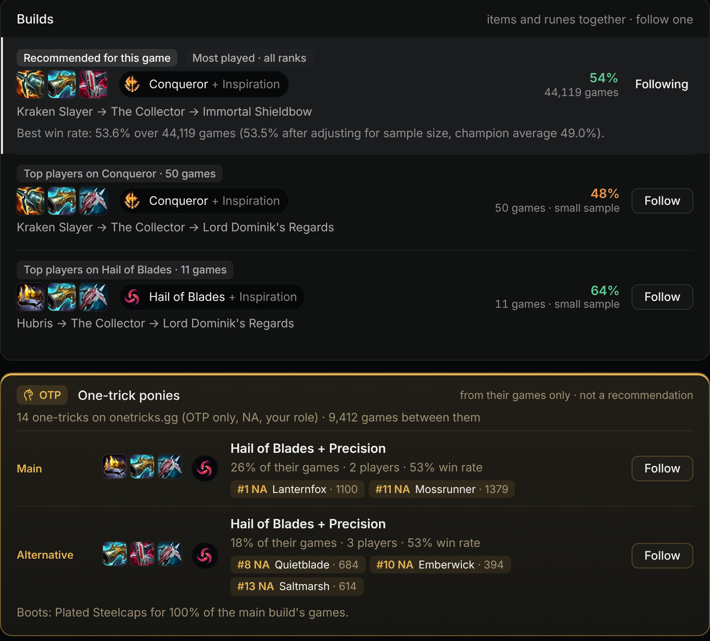
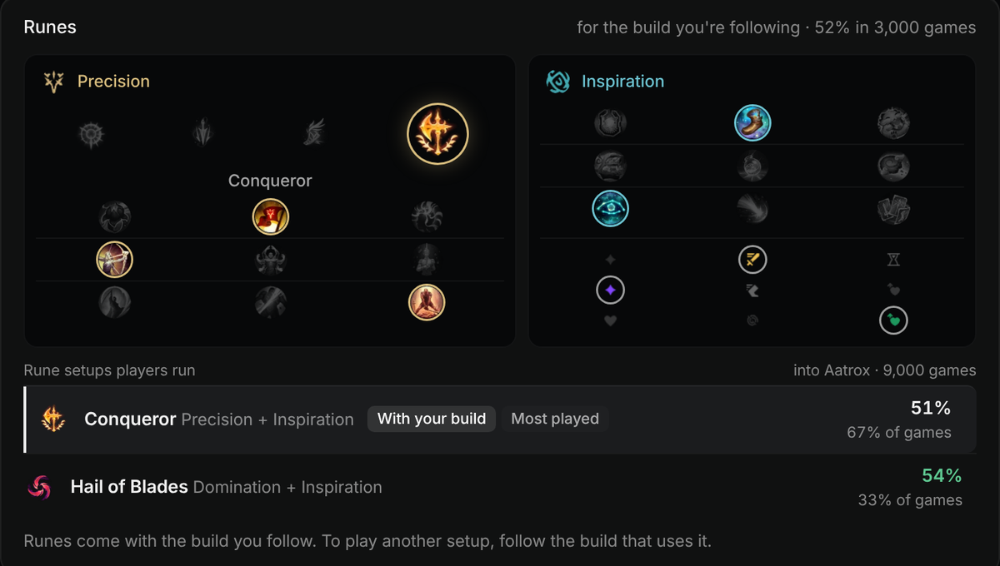
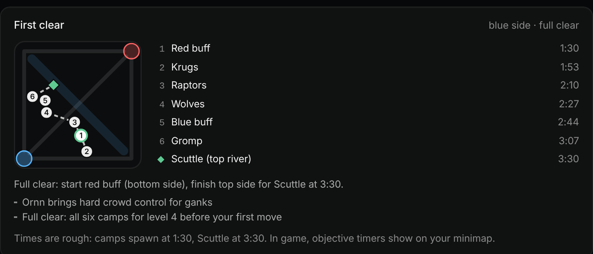
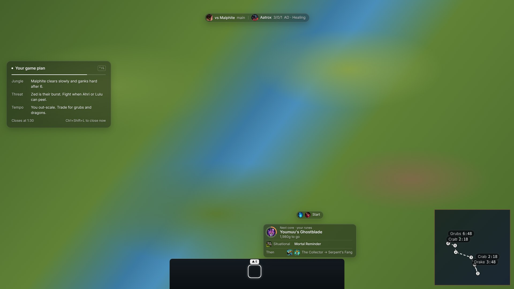
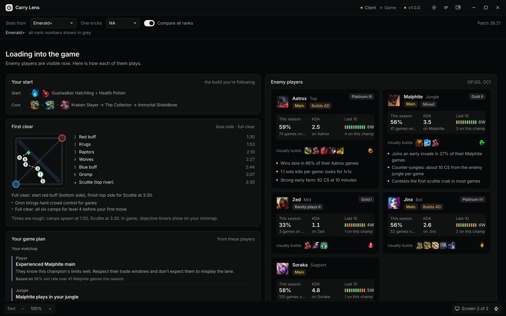

 

**[Features](#features)** · **[Screenshots](#screenshots)** · **[Install](#install)** · **[Fair play](#fair-play)** · **[Privacy](#privacy)** · **[FAQ](#faq)**

---

**Carry Lens** is a free companion app for League of Legends. It gives you the build and runes for the game you're in (chosen together, from the stats), a read on each enemy player before the game starts, and a second-monitor view plus a quiet in-game overlay that tells you what to buy next. It only uses Riot's official APIs and only shows you what the game already lets you see.

## Features

| | |
|---|---|
| 🧭 **The Build: items and runes together** | Several complete builds for your champion, role and matchup, each with the rune page its players actually use. The recommended one is the best win rate into your lane opponent, adjusted for sample size. Follow a build and its runes come with it. |
| ⚡ **Send to League** | One click puts the rune page and your summoner spells into the client (Flash on D or F, your choice). Nothing changes unless you press it. |
| 🐎 **One-trick ponies** | What the champion's one-tricks actually play, from onetricks.gg (OTP-flagged players only, in your region and role): a main build and an alternative, with the players named. Kept separate from the recommendation. |
| 🔍 **Enemy scouting** | On the loading screen: how each enemy plays their champion, their recent form, mastery, and the habits that matter (early invades, kill participation, lane win rate). |
| 🗺️ **Game plan** | A short plan for this game: your matchup, their biggest threat, and whether your team wants it early or late. It shows on the overlay for the first 90 seconds. |
| 🛒 **Next item, in game** | The next core item with gold still needed. The bar turns from red to green as you save up, with a situational option when the enemy team calls for one. |
| 🧩 **What the team needs** | Anti-heal, armour shred and the rest: who on your team should buy it, so you don't get three Executioner's Calling or none. |
| 🌿 **Jungle** | Take Smite and you get a first-clear path for your side of the map, plus dragon, grubs, Herald and Baron timers drawn on your minimap from the kill feed. |
| 🖥️ **Built for two monitors** | Champ select, loading screen and in-game views on your second screen, sized so the in-game view fits without scrolling. There's also a browser view for a phone or tablet on your Wi-Fi. |
| 📈 **After the game** | A recap against your lane opponent and your own recent games: CS, vision, kill participation, and deaths just before objectives. |
| 🔄 **Updates itself** | Checks for a new version when it starts, downloads it in the background, checks it against its published SHA-256, and puts an update button in the top bar. It never installs mid-game. |

## Screenshots

<table>
<tr><td colspan="2">

**In game, second monitor.** Your next buy, every enemy's threat level, what your team still needs and your game plan, all on one screen.

</td></tr>
<tr><td width="50%" valign="top">

**Builds and one-tricks.** Each build comes with its runes. One-trick builds are listed separately, with the players behind them.

</td><td width="50%" valign="top">

**Runes for the build you follow,** laid out like the client's rune page, ready to send to League.

**First clear** for your side of the map when you take Smite.

</td></tr>
<tr><td colspan="2">

**The in-game overlay.** Small frosted panels around League's own HUD: the game plan for the first 90 seconds, your matchup and their biggest threat along the top, the next item above your item slots, and objective timers on the minimap. Clicks pass straight through to the game. (The game is a stand-in background in this picture.)

</td></tr>
<tr><td colspan="2">

**Loading screen.** How each enemy player plays their champion, before the game starts.

</td></tr>
</table>

## Install

1. Download **CarryLens-Setup-x.y.z.exe** from the [latest release](https://github.com/ImDaimo/CarryLens-Prod/releases/latest).
2. Run it. Windows may say *"Windows protected your PC"* because the installer isn't code-signed: click **More info**, then **Run anyway**.
3. Carry Lens opens and waits for the League client. Start League, and it connects by itself.

Want the overlay on the same screen as the game? Set League's **Settings → Video → Window Mode** to **Borderless**. If Carry Lens is on its own monitor, any window mode works.

**No League handy?** Open **Carry Lens Demo** from the Start menu. It plays through a champ select, loading screen and game at 30× speed.

**Requirements:** Windows 10 or 11 (64-bit) and League of Legends. Everything else is included; no administrator rights needed.

### Controls

| Shortcut | What it does |
|---|---|
| <kbd>Ctrl</kbd> + <kbd>Shift</kbd> + <kbd>K</kbd> | Line the overlay up with League's HUD (drag the pieces, scroll to resize) |
| <kbd>Ctrl</kbd> + <kbd>Shift</kbd> + <kbd>L</kbd> | Hide or show the overlay (and close the game-plan card) |
| <kbd>Ctrl</kbd> + <kbd>Shift</kbd> + <kbd>J</kbd> | Compact view |
| <kbd>Ctrl</kbd> + <kbd>Shift</kbd> + <kbd>F</kbd> | Fill the screen / restore |
| <kbd>Ctrl</kbd> + <kbd>Shift</kbd> + <kbd>M</kbd> | Move Carry Lens to your other monitor |

Shortcuts only work while League is open.

## Fair play

Carry Lens follows Riot's third-party app rules:

- ✅ Uses only Riot's official APIs: the League client's local API and the Live Client Data API. It never reads or writes game memory and never injects anything.
- ✅ Shows only what you can already see: champ select, your scoreboard and the kill feed.
- ✅ Changes something in the client only when you press **Send to League** (a rune page called "Carry Lens" and your two summoner spells).
- ❌ No enemy ability, ultimate or summoner-spell timers.
- ❌ No enemy jungle tracking. Objective timers come only from the public kill feed.
- ❌ No in-game prompts telling you what to do ("go gank top"). The game plan is a pre-game summary, and the overlay sticks to items and public timers.
- ❌ No input automation and no chat.
- ❌ No other players' names during champ select. Enemy players are looked up from the loading screen on, when the game shows their names.

## Privacy

- No account and no sign-up. Carry Lens never asks for your Riot login.
- It runs on your PC. It reads the League client's local API and sends only public lookups to the stat sites: champion names, and the Riot IDs shown on the loading screen.
- Settings and caches stay in `%APPDATA%\Carry Lens`. Nothing is uploaded, and there's no tracking or analytics.
- The browser view for phones and tablets is off for other devices until you switch it on.

## Where the data comes from

| Data | Source |
|---|---|
| Builds, runes, spells, skill order, matchups | [OP.GG](https://op.gg), the current patch, cached for a few hours |
| One-trick builds | [onetricks.gg](https://www.onetricks.gg), OTP-flagged players in your chosen region |
| Champ select, your rune page, HUD settings | The League client's local API |
| Items, levels, scores, objectives in game | Riot's Live Client Data API |
| Champions, items, runes and icons | Riot's Data Dragon, updated each patch |

## FAQ

<b>Is it free?</b>

Yes. No ads, no account, no premium tier.

<b>Can I get banned for using it?</b>

Carry Lens sticks to Riot's official APIs and the published third-party rules (see [Fair play](#fair-play)): no memory reading, no automation, no enemy cooldown timers. It works the way established companion apps do. As with any third-party app, Riot's rules are theirs to change, and Carry Lens will follow them.

<b>Why does Windows warn me when I install it?</b>

The installer isn't code-signed yet. Code-signing certificates cost money each year. Click **More info → Run anyway**. Each release also publishes the installer's SHA-256 in `latest.json` if you want to check the file.

<b>Does it work with ARAM or other modes?</b>

It's built for Summoner's Rift (ranked and normals). ARAM gets runes and builds as a fallback. Other modes are shown as not supported.

<b>How do updates work?</b>

When Carry Lens starts, it checks this repository's releases. A new version downloads in the background and is verified, then an **Update** button appears in the top bar. It never installs during a game.

<b>Which regions does it support?</b>

Every server for scouting (set automatically from your client, or pick one in Settings). For one-trick builds, choose NA, EUW, EUNE, KR, OCE, BR, LAN, LAS, JP, TR or all regions in the top bar.

## Releases

Every version is listed on the [releases page](https://github.com/ImDaimo/CarryLens-Prod/releases). This repository holds installers and this page only.

---

Carry Lens isn't endorsed by Riot Games and doesn't reflect the views or opinions of Riot Games or anyone officially involved in producing or managing Riot Games properties. Riot Games, and all associated properties are trademarks or registered trademarks of Riot Games, Inc. Stats from OP.GG and onetricks.gg, who aren't affiliated with Carry Lens.
